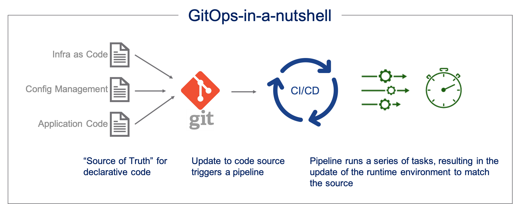

<div align="center">


# Argo CD Zero to Hero 🚀


### A Hands-On Guide to GitOps and Argo CD — From Fundamentals to Production

Master GitOps and Argo CD, from fundamentals to production-ready Kubernetes deployments, Helm, Kustomize, and progressive delivery with Argo Rollouts.



[![Argo CD][badge-argocd]][argocd-docs]
[![Kubernetes][badge-k8s]][k8s]
[![Helm][badge-helm]][helm]
[![Kustomize][badge-kustomize]][kustomize]
[![Argo Rollouts][badge-rollouts]][rollouts]
[![GitHub Actions][badge-gha]][gha]

[![License: MIT][badge-license]](./LICENSE)
[![PRs Welcome][badge-prs]](#-contributing)
[![Modules][badge-modules]](#-learning-roadmap)
[![Level][badge-level]](#-learning-roadmap)
[![Hands-on Projects][badge-projects]](#-hands-on-projects)

**GitOps • Kubernetes • Continuous Delivery • Helm • Kustomize • Argo Rollouts**

[📖 Roadmap](#-learning-roadmap) •
[🧪 Projects](#-hands-on-projects) •
[🧰 Prerequisites](#-prerequisites) •
[🏗️ Structure](#️-repository-structure) •
[🤝 Contribute](#-contributing)

</div>

<p align="center">
  
</p>

## 📚 Table of Contents

| # | Section |
|:---:|---|
| 1 | [About This Repository](#-about-this-repository) |
| 2 | [How GitOps Works](#-how-gitops-works) |
| 3 | [Learning Roadmap](#-learning-roadmap) |
| 4 | [Prerequisites](#-prerequisites) |
| 5 | [Tools and Technologies](#-tools-and-technologies) |
| 6 | [Hands-On Projects](#-hands-on-projects) |
| 7 | [Repository Structure](#️-repository-structure) |
| 8 | [How to Use This Repository](#-how-to-use-this-repository) |
| 9 | [Official Resources](#-official-resources) |
| 10 | [Contributing](#-contributing) |
| 11 | [License](#-license) |

<p align="center">
  
</p>

## 🎯 About This Repository

This repository provides a structured, practical learning path for understanding GitOps and mastering Argo CD.

You will learn how to:

- Manage Kubernetes applications declaratively
- Synchronize deployments from Git repositories
- Manage multiple environments
- Integrate CI/CD pipelines
- Implement progressive delivery strategies

By completing the modules and projects, you will gain hands-on experience with GitOps workflows used in modern DevOps and Platform Engineering environments.

## 🔄 How GitOps Works

```
 ┌───────────┐   push    ┌──────────────┐   watch / pull   ┌────────────────┐
 │ Developer │ ────────► │  Git Repo    │ ◄─────────────── │    Argo CD     │
 └───────────┘           │ (desired     │                  │  (controller)  │
                         │  state)      │                  └───────┬────────┘
                         └──────────────┘                          │ sync / reconcile
                                                                   ▼
                                                        ┌────────────────────┐
                                                        │ Kubernetes Cluster │
                                                        │   (actual state)   │
                                                        └────────────────────┘
        Git is the single source of truth. Argo CD continuously
        detects drift and reconciles the cluster to match Git.
```

<p align="center">
  
</p>

## 🗺️ Learning Roadmap

```
 FOUNDATIONS          CORE ARGO CD            DELIVERY & SECURITY       PRODUCTION
 ───────────          ────────────            ───────────────────       ──────────
 01 Fundamentals ──►  03 Architecture   ──►   05 Helm / Kustomize  ──►  07 Monitoring
 02 Install & App     04 App Mgmt & Sync      06 Security & CI/CD       08 Projects
```

| Module | Topics |
|:---:|---|
| [01 - GitOps and Argo CD Fundamentals](01-gitops-and-argocd-fundamentals/README.md) | GitOps principles, declarative configuration, continuous delivery, and Argo CD fundamentals |
| [02 - Installation and First Application](02-argocd-installation-and-first-application/README.md) | Install Argo CD, access the UI and CLI, connect Git repositories, and deploy your first application |
| [03 - Architecture and Core Concepts](03-argocd-architecture-and-core-concepts/README.md) | API server, repository server, application controller, Applications, and AppProjects |
| [04 - Application Management and Sync](04-application-management-and-sync/README.md) | Application lifecycle, sync policies, automated sync, pruning, self-healing, health status, and rollback |
| [05 - Helm, Kustomize and ApplicationSets](05-helm-kustomize-and-applicationsets/README.md) | Helm charts, Kustomize overlays, multi-environment deployments, and ApplicationSets |
| [06 - GitOps Security and CI/CD](06-gitops-security-and-cicd/README.md) | RBAC, AppProjects, repository credentials, secrets management, and CI/CD integration |
| [07 - Monitoring, Troubleshooting and Production](07-monitoring-troubleshooting-and-production/README.md) | Logs, metrics, common failures, troubleshooting, high availability, and production best practices |
| [08 - Projects and Interview Preparation](08-hands-on-projects-and-interview-preparation/README.md) | End-to-end GitOps projects, Blue-Green deployment, Canary deployment, and interview preparation |

<p align="center">
  
</p>

## 🧰 Prerequisites

| Area | Topics |
|---|---|
| **Fundamentals** | Linux commands, Git and GitHub |
| **Containers** | Docker and container images |
| **Kubernetes** | Pods, Deployments, Services, and Namespaces |
| **Configuration** | YAML configuration files |
| **Delivery** | CI/CD concepts |

> 💡 Basic Kubernetes knowledge is recommended before installing Argo CD.

## 🛠️ Tools and Technologies

| Category | Tools |
|---|---|
| Version Control | Git, GitHub |
| Containerization | Docker |
| Container Orchestration | Kubernetes |
| GitOps and Continuous Delivery | Argo CD |
| Progressive Delivery | Argo Rollouts |
| Application Packaging | Helm |
| Configuration Management | Kustomize |
| CI/CD | GitHub Actions, Jenkins |
| Monitoring | Prometheus, Grafana |

<p align="center">
  
</p>

## 🧪 Hands-On Projects

Throughout this repository, you will build practical GitOps workflows.

| # | Project | What You Will Do |
|:---:|---|---|
| 1 | **Deploy an Application with Argo CD** | Connect a Git repository, deploy to Kubernetes, observe health and sync status, and update configuration through Git |
| 2 | **Manage Multiple Environments** | Organize dev, staging, and production configs; use Helm or Kustomize for environment-specific values |
| 3 | **Integrate GitOps with CI/CD** | Build and test images, publish to a registry, update the deployment repo, and let Argo CD sync |
| 4 | **Blue-Green Deployment** | Use Argo Rollouts to run versions side by side, test via a preview Service, promote, and plan rollback |
| 5 | **Canary Deployment** | Gradually shift traffic, validate behavior, and promote or abort the rollout |
| 6 | **Troubleshoot GitOps Deployments** | Investigate sync failures, unhealthy apps, drift, controller logs, and Kubernetes events |

<details>
<summary><b>Project details</b></summary>

### 1. Deploy an Application with Argo CD

- Connect a Git repository to Argo CD.
- Deploy an application to Kubernetes.
- Observe application health and synchronization status.
- Update the application configuration through Git.

### 2. Manage Multiple Environments

- Organize development, staging, and production configurations.
- Use Helm or Kustomize to manage environment-specific values.
- Deploy applications using separate configurations for each environment.

### 3. Integrate GitOps with CI/CD

- Build and test container images through a CI pipeline.
- Publish images to a container registry.
- Update the deployment repository with the desired image version.
- Let Argo CD synchronize the updated configuration to Kubernetes.

### 4. Implement Blue-Green Deployment

Use **Argo Rollouts** alongside Argo CD to deploy a new application version without immediately replacing the active version.

- Run the current and new versions side by side.
- Test the new version through a preview Service.
- Promote the new version to receive production traffic.
- Understand rollback and recovery considerations.

### 5. Implement Canary Deployment

Use Argo Rollouts to progressively release a new application version.

- Gradually shift traffic to the new version.
- Validate application behavior during the rollout.
- Promote or abort the rollout based on validation.
- Understand how progressive delivery reduces release risk.

### 6. Troubleshoot GitOps Deployments

- Investigate synchronization failures.
- Troubleshoot unhealthy applications and failed deployments.
- Understand configuration drift and reconciliation.
- Inspect application status, controller logs, and Kubernetes events.

</details>

<p align="center">
  
</p>

## 🏗️ Repository Structure

```text
ArgoCD-Zero-to-Hero/
├── README.md
├── assets/
│   ├── gitops.png
│   └── argo.png
├── 01-gitops-and-argocd-fundamentals/
│   └── README.md
├── 02-argocd-installation-and-first-application/
│   └── README.md
├── 03-argocd-architecture-and-core-concepts/
│   └── README.md
├── 04-application-management-and-sync/
│   └── README.md
├── 05-helm-kustomize-and-applicationsets/
│   └── README.md
├── 06-gitops-security-and-cicd/
│   └── README.md
├── 07-monitoring-troubleshooting-and-production/
│   └── README.md
├── 08-hands-on-projects-and-interview-preparation/
│   └── README.md
└── LICENSE
```

## 🚀 How to Use This Repository

1. **Module 01:** understand GitOps and Argo CD fundamentals.
2. **Module 02:** install Argo CD and deploy your first application.
3. **Modules 03–04:** learn the architecture and synchronization process.
4. **Modules 05–06:** explore Helm, Kustomize, security, and CI/CD integrations.
5. **Module 07:** learn production monitoring and troubleshooting.
6. **Module 08:** complete the hands-on projects, including Blue-Green and Canary deployments.

Each module contains its own README with explanations, practical examples, commands, and exercises.

> **💡 Tip:** Start with a local Kubernetes cluster such as kind or minikube. Clean up test resources when finished, and check cloud resource costs before running labs on managed Kubernetes services.

<p align="center">
  
</p>

## 🔗 Official Resources

| Resource | Link |
|---|---|
| 📘 Argo CD Documentation | [argo-cd.readthedocs.io](https://argo-cd.readthedocs.io/en/stable/) |
| 💻 Argo CD Source | [GitHub Repository](https://github.com/argoproj/argo-cd) |
| 🧩 Example Applications | [argocd-example-apps](https://github.com/argoproj/argocd-example-apps) |
| 🚦 Argo Rollouts | [Documentation](https://argoproj.github.io/argo-rollouts/) |
| 🔵🟢 Blue-Green Strategy | [Argo Rollouts Blue-Green](https://argoproj.github.io/argo-rollouts/features/bluegreen/) |
| 🐤 Canary Strategy | [Argo Rollouts Canary](https://argoproj.github.io/argo-rollouts/features/canary/) |
| ☸️ Kubernetes | [Documentation](https://kubernetes.io/docs/) |
| ⎈ Helm | [Documentation](https://helm.sh/docs/) |
| 🧱 Kustomize | [Documentation](https://kubectl.docs.kubernetes.io/references/kustomize/) |

## 🤝 Contributing

Suggestions, corrections, and improvements are welcome. Open an issue or submit a pull request to help improve this learning resource.

## 📄 License

This project is distributed under the license specified in the [`LICENSE`](./LICENSE) file.

<p align="center">
  
</p>

<div align="center">

### Happy Learning! Master GitOps one module at a time. 🚀

⭐ If you find this repository helpful, consider giving it a star!


</div>

<!-- Badge references -->
[badge-argocd]: https://img.shields.io/badge/Argo_CD-EF7B4D?style=for-the-badge&logo=argo&logoColor=white
[badge-k8s]: https://img.shields.io/badge/Kubernetes-326CE5?style=for-the-badge&logo=kubernetes&logoColor=white
[badge-helm]: https://img.shields.io/badge/Helm-0F1689?style=for-the-badge&logo=helm&logoColor=white
[badge-kustomize]: https://img.shields.io/badge/Kustomize-326CE5?style=for-the-badge&logo=kubernetes&logoColor=white
[badge-rollouts]: https://img.shields.io/badge/Argo_Rollouts-EF7B4D?style=for-the-badge&logo=argo&logoColor=white
[badge-gha]: https://img.shields.io/badge/GitHub_Actions-2088FF?style=for-the-badge&logo=githubactions&logoColor=white
[badge-license]: https://img.shields.io/badge/License-MIT-green?style=flat-square
[badge-prs]: https://img.shields.io/badge/PRs-welcome-brightgreen?style=flat-square
[badge-modules]: https://img.shields.io/badge/Modules-8-blue?style=flat-square
[badge-level]: https://img.shields.io/badge/Level-Beginner_to_Advanced-orange?style=flat-square
[badge-projects]: https://img.shields.io/badge/Hands--on-Projects-red?style=flat-square

<!-- Link references -->
[argocd-docs]: https://argo-cd.readthedocs.io/en/stable/
[k8s]: https://kubernetes.io/
[helm]: https://helm.sh/
[kustomize]: https://kustomize.io/
[rollouts]: https://argoproj.github.io/argo-rollouts/
[gha]: https://github.com/features/actions
